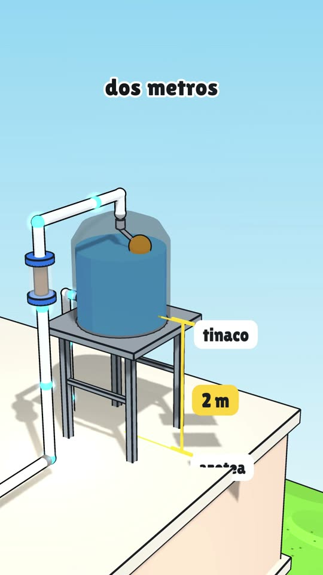
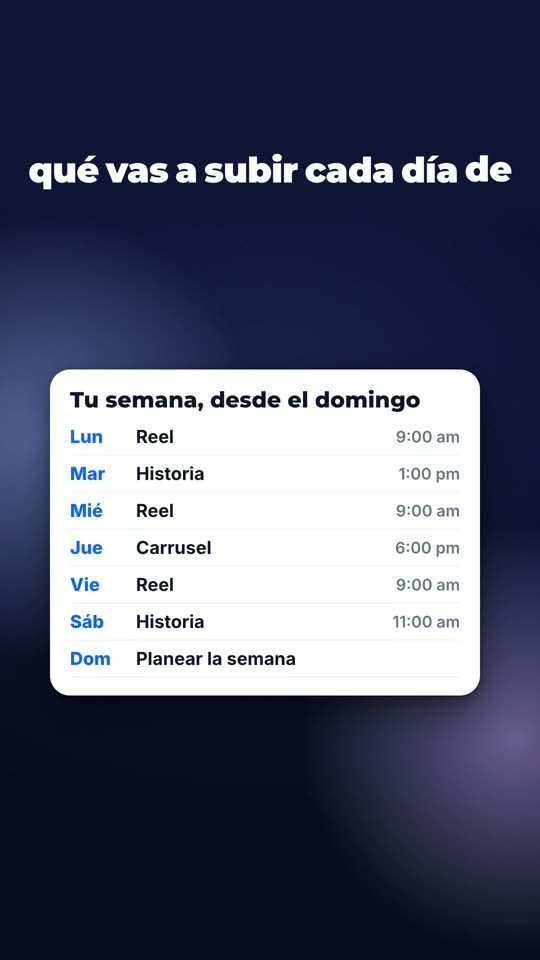

# Fábrica de videos animados

Videos explicativos verticales (9:16) de esos que arman algo **problema por problema**: "si subes un tambo a tu azotea, ya tienes un tinaco… pero llenarlo a cubetazos te quita toda la mañana…". Cada problema se ve fallar en rojo, cada solución aparece en pantalla y al final tienes el objeto completo.

Todo es código: el guion es un archivo de texto, la animación es una escena en JavaScript y el render sale de tu compu. No usa generadores de video con IA, así que no gastas créditos de video y cada video sale igual cada vez que lo renderizas. Está pensado para trabajarse con **Claude Code**: tú le pides el video y Claude escribe el guion, la voz, la animación y lo revisa antes de renderizar.

La guía paso a paso está en el Lab: **[Videos animados con Claude](https://www.davidiriza.com/lab/videos-animados-con-claude)**.

## Cómo se ven

Los siete videos de ejemplo vienen en [Releases](../../releases) (MP4 listos para ver) y su código está en `videos/`:

| Video | Estilo | Qué muestra |
|---|---|---|
| `videos/tinaco` | 3D `toon` (caricatura con contorno de tinta) | cómo funciona el tinaco de tu casa |
| `videos/tinaco-maqueta` | 3D `maqueta` (diorama en corte) | el mismo guion en otro estilo |
| `videos/tinaco-plano` | 3D `plano` (ilustración isométrica) | el mismo guion en otro estilo |
| `videos/retroexcavadora` | 3D `toon` con maquinaria que se mueve por poses | cómo funciona una retroexcavadora |
| `videos/embudo-meta` | `pizarra` (2D dibujado con plumón) | un embudo de venta en Meta |
| `videos/embudo-lentes` | `motion` claro (pantallas web realistas) | un embudo para vender unos lentes |
| `videos/contenido-redes` | `motion` noche, con fotos | cómo crear contenido para redes |

<p>
  
  
  
</p>

## Qué necesitas

- Una Mac (los scripts usan `zsh` y Homebrew; en Linux también corre si instalas lo mismo).
- [Claude Code](https://claude.com/claude-code).
- Node 20+, Python 3.10+, ffmpeg, HyperFrames y whisper.cpp. El script `scripts/requisitos.sh` revisa qué tienes y te dice el comando exacto para instalar lo que falte.
- Para la voz: una llave de [ElevenLabs](https://elevenlabs.io) (un video de 1:40 gasta unos 720 créditos). Si no tienes, hay una voz de prueba gratis que corre en tu compu (`--kokoro`).

## Empezar

```bash
git clone https://github.com/davidiriza-lab/fabrica-animados.git
cd fabrica-animados
scripts/requisitos.sh
```

Abre la carpeta con Claude Code y pídele:

> Renderiza el video de ejemplo del tinaco.

Los ejemplos traen su narración, así que ese primer render no gasta créditos. Tarda unos minutos y queda en `videos/tinaco/renders/tinaco.mp4`.

Cuando funcione, pide el tuyo:

> Hazme un video animado de cómo funciona un refrigerador.

> Hazme un video en estilo motion de cómo conseguir clientes por WhatsApp, para una estética.

Claude lee `CLAUDE.md` y las guías, te propone el guion para que lo apruebes y después se encarga de lo demás.

## Cómo funciona por dentro

```
plan.json  →  voz.py  →  tiempos.py  →  escena.js  →  revisar.mjs + vigía  →  render.sh  →  MP4
 (guion)     (ElevenLabs)  (Whisper:     (la animación,   (revisores antes      (HyperFrames)
                           cada palabra  amarrada a cada   de renderizar)
                           con su tiempo) palabra que se dice)
```

1. **El guion** (`plan.json`) es una lista de frases ("beats") con su tipo: base, problema, solución, término, dato. La guía `guias/NARRATIVA.md` explica la plantilla, sacada del análisis de 50 videos virales de este formato.
2. **La voz** se graba de corrido con ElevenLabs y Whisper marca el instante de cada palabra.
3. **La escena** (`escena.js`) anima cada cosa justo cuando se dice: `V.dice("cubetas", "cubetazos")` es el segundo exacto en el que suena esa palabra. Hay dos motores:
   - `motor/` (Three.js): un mundo 3D que se arma pieza por pieza en un solo plano continuo. Las piezas se colocan por relaciones (`sobre`, `conectar`, `montar`) y la cámara encuadra sola con `camara.mostrar`.
   - `motor-motion/` (HTML + GSAP): motion graphics con pantallas web realistas (celular, anuncio, landing, WhatsApp, métricas) en un lienzo grande que la cámara recorre como pizarra.
4. **Los revisores** atrapan los errores antes de gastar un render: piezas que flotan, texto que no se lee o que queda encima de una foto, subtítulos adelantados, tramos donde se habla y nada se mueve. Además, un "vigía" (un agente aparte de Claude) mira fotos de cada frase y busca lo que no tiene sentido común. Después del render, `revisar_video.py` revisa saltos, parpadeos, volumen y partes estáticas del MP4.
5. **El render** lo hace [HyperFrames](https://hyperframes.heygen.com) con un solo proceso y prioridad baja, para que tu compu no se trabe.

## Estructura

| Carpeta | Qué hay |
|---|---|
| `guias/` | `NARRATIVA.md` (cómo se escribe), `ESCENAS.md` (cómo se anima y qué revisa el revisor) y `VIGIA.md` (el prompt del vigía) |
| `motor/` | motor 3D: `mundo.js`, `piezas.js` (biblioteca de piezas), `textos.js` (subtítulos amarrados a la voz) y `vendor/` (three.js y GSAP locales) |
| `motor-motion/` | motor de motion graphics: `ui.js`, `piezas.js` (celular, post, anuncio, landing, WhatsApp…) y `ui.css` (diseño y temas) |
| `scripts/` | el flujo completo, paso por paso (`generar.py` corre todo) |
| `videos/<slug>/` | cada video: `plan.json`, `escena.js`, `timing.json`, la narración y sus imágenes |

## Licencia

El código es MIT (ver `LICENSE`). three.js, GSAP y las fuentes tienen sus propias licencias, listadas en `AVISOS.md`.

Hecho por [David Iriza](https://davidiriza.com).
