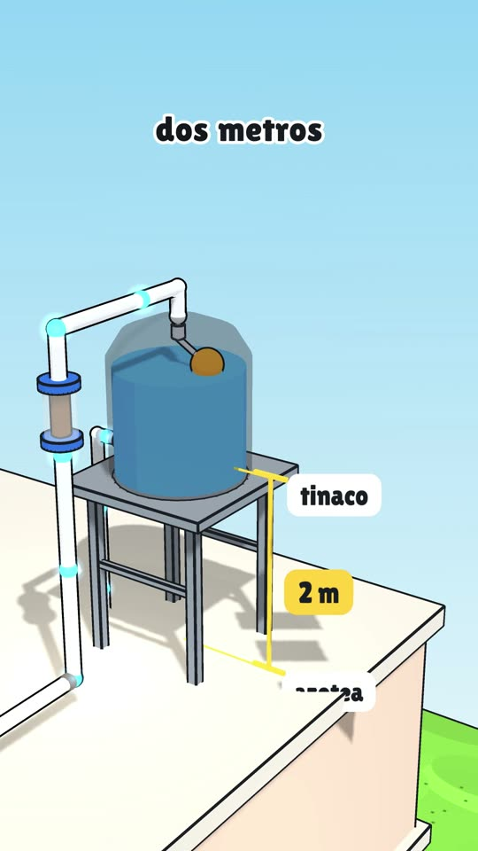
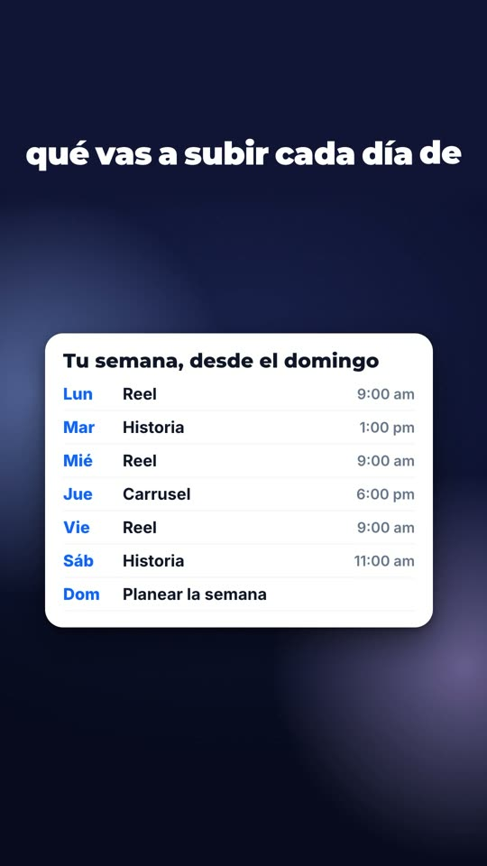

# Fábrica de videos animados

**Le pides a Claude un video que explique algo y te entrega el MP4 vertical, con voz y subtítulos, sin pagar generadores de video.**

Hace los explicadores que arman algo **problema por problema**: "si subes un tambo a tu azotea, ya tienes un tinaco… pero llenarlo a cubetazos te quita toda la mañana…". Cada problema se ve fallar en rojo, cada solución aparece en pantalla justo cuando se nombra y al final queda el objeto completo. Sirve igual para cosas físicas (una casa, una máquina) que para marketing y procesos (un embudo, cómo crear contenido).

Es para quien publica en redes y quiere este formato sin contratar un estudio y sin saber programar: tú apruebas el guion y Claude Code escribe la voz, la animación y el render. Todo es código que corre en tu compu, así que el mismo video sale igual cada vez y cambiar una frase no obliga a rehacer lo demás.

<p>
  
  
  
</p>

Los siete videos de ejemplo ya renderizados están en [Releases](../../releases), por si quieres verlos antes de instalar nada.

## Instalar: pega esto en Claude Code

Abre Claude Code en la carpeta donde guardas tus proyectos y pega esto:

```
Clona https://github.com/davidiriza-lab/fabrica-animados aquí, entra a la carpeta y corre scripts/requisitos.sh. Si falta algo, explícame para qué sirve, enséñame el comando que imprime y pídeme permiso antes de instalarlo. Cuando la parte de "Para renderizar los ejemplos" esté completa, lee el CLAUDE.md del repo, renderiza el video de ejemplo del tinaco (no gasta créditos) y dime dónde quedó el archivo.
```

Claude instala lo que falte pidiéndote permiso en cada paso y termina con un video de prueba. Ese primer render tarda unos minutos y no cuesta nada: los ejemplos ya traen su narración.

<details>
<summary>Si prefieres hacerlo a mano</summary>

```bash
git clone https://github.com/davidiriza-lab/fabrica-animados.git
cd fabrica-animados
scripts/requisitos.sh          # revisa qué tienes y te da el comando de lo que falte
python3 scripts/armar.py videos/tinaco && scripts/render.sh videos/tinaco
```

El video queda en `videos/tinaco/renders/tinaco.mp4`.
</details>

## Qué necesitas

| | Qué | Para qué |
|---|---|---|
| **Siempre** | Una Mac y [Claude Code](https://claude.com/claude-code) | Está hecha y probada en Mac. En Linux y Windows no está probada. |
| **Para renderizar los ejemplos** | Node 20 o más nuevo, Python 3.10 o más nuevo, ffmpeg y [HyperFrames](https://hyperframes.heygen.com) | Arman, revisan y renderizan el video. Todo es gratis. |
| **Para hacer tus propios videos** | whisper.cpp y su modelo (1.6 GB, se baja una sola vez) | Marca en qué segundo suena cada palabra, para que la animación caiga justo ahí. Gratis y corre en tu compu. |
| **Opcional** | Una llave de [ElevenLabs](https://elevenlabs.io) | La voz buena. Es lo único que cuesta: unos 720 créditos por un video de 1:40. Sin llave, los videos salen con una voz de prueba gratis que corre en tu compu (suena menos natural, pero sirve para ensayar todo el proceso). |
| **Opcional** | Imágenes | Solo si quieres fotos dentro de un video de marketing. Puedes poner las tuyas o generarlas con la herramienta que ya uses. |
| **Opcional** | Blender | Solo para darle acabado de cine a una toma 3D. Es experimental y no hace falta para nada de lo demás. |

`scripts/requisitos.sh` revisa las tres partes y te dice el comando exacto de lo que falte. No hay que correr `npm install`: las librerías de animación ya vienen dentro del repo.

## Cómo se usa

Abre la carpeta `fabrica-animados` con Claude Code y pídele el video con tus palabras. Algunas frases que funcionan:

> Renderiza el video de ejemplo del tinaco y dime dónde quedó.

> Hazme un video animado de cómo funciona un refrigerador. Enséñame primero el guion.

> Hazme un video en estilo motion de cómo una estética puede conseguir clientes por WhatsApp. Es para dueñas de estéticas que nunca han hecho publicidad. Que dure menos de un minuto.

> Todavía no tengo ElevenLabs: usa la voz de prueba gratis.

> Cambia la frase del segundo problema por "pero se te olvida cerrar la llave y se tira el agua", sin volver a grabar lo demás.

Lo que pasa después:

1. Claude elige el estilo (o usa el que le digas) y escribe el guion. **Te lo enseña y espera tu OK**, porque la voz es lo único que cuesta. Léelo en voz alta: si una frase no se entiende al oírla, tampoco se va a entender en el video.
2. Graba la voz y marca el segundo exacto de cada palabra.
3. Escribe la animación amarrada a esas palabras.
4. La pasa por los revisores antes de renderizar y corrige lo que encuentren.
5. Renderiza. El video queda en `videos/<nombre>/renders/<nombre>.mp4` (1080×1920, con el volumen listo para redes). Si se lo pides, también te deja escrito el texto del post.

El primer video de un tema nuevo suele pedir dos o tres vueltas de correcciones. Del segundo en adelante, con el mismo estilo, va mucho más rápido.

## Qué trae

**Cinco estilos.** Los tres 3D comparten la misma escena: el mismo video sale en cualquiera de ellos cambiando una palabra.

| Estilo | Cómo se ve | Para qué |
|---|---|---|
| `toon` | Caricatura 3D con contorno de tinta | Cómo funciona algo físico: una casa, una máquina, una instalación |
| `maqueta` | Diorama en corte sobre cuadrícula azul | Lo mismo, con look de ingeniería |
| `plano` | Ilustración isométrica de colores planos | Lo mismo, más limpio y gráfico |
| `pizarra` | Dibujo de plumón sobre papel | Temas que no son físicos: procesos, ideas |
| `motion` | Pantallas web realistas (celular, anuncio, landing, WhatsApp, métricas), en tema claro o noche | Marketing, ventas y negocios digitales |

**Siete ejemplos completos**, con guion, narración y tiempos listos para renderizar sin gastar créditos. Sus MP4 están en [Releases](../../releases).

| Ejemplo | Estilo | Qué muestra |
|---|---|---|
| `videos/tinaco` | `toon` | cómo funciona el tinaco de tu casa |
| `videos/tinaco-maqueta` | `maqueta` | el mismo guion en otro estilo |
| `videos/tinaco-plano` | `plano` | el mismo guion en otro estilo |
| `videos/retroexcavadora` | `toon`, con una máquina que se mueve pieza por pieza | cómo funciona una retroexcavadora (62 s, el formato corto) |
| `videos/embudo-meta` | `pizarra` | un embudo de venta en Meta |
| `videos/embudo-lentes` | `motion` claro | un embudo para vender unos lentes |
| `videos/contenido-redes` | `motion` noche, con fotos | cómo crear contenido para redes |

**Lo que hace que el video se entienda y no salga roto:**

- **La plantilla del guion** (`guias/NARRATIVA.md`), sacada del análisis de 50 videos virales de este formato: cómo se abre, cómo se encadenan los problemas y dónde se paga el gancho.
- **Dos motores de animación.** `motor/` arma un mundo 3D pieza por pieza en un solo plano continuo, con una biblioteca de piezas prefabricadas (casa, tinaco, tuberías, maquinaria de obra). `motor-motion/` hace motion graphics con pantallas web sobre un lienzo que la cámara recorre.
- **Revisores antes del render.** Uno automático abre el video sin renderizarlo y busca piezas que flotan o quedan fuera de cuadro, texto que no se lee, subtítulos adelantados y tramos donde se habla y nada se mueve. Otro, el "vigía", es un segundo agente de Claude que mira fotos de cada frase y busca lo que no tiene sentido común. Después del render, otro script revisa el MP4 (saltos, parpadeos, volumen, partes quietas).
- **Cuidado de tu compu.** El render usa un solo proceso con prioridad baja para que puedas seguir trabajando, y al terminar se borra todo lo intermedio.

<details>
<summary>Cómo funciona por dentro</summary>

```
plan.json  →  voz.py  →  tiempos.py  →  escena.js  →  revisar.mjs + vigía  →  render.sh  →  MP4
 (guion)      (la voz)   (Whisper:      (la animación,   (revisores antes      (HyperFrames)
                         cada palabra   amarrada a cada   de renderizar)
                         con su tiempo) palabra que se dice)
```

| Carpeta | Qué hay |
|---|---|
| `CLAUDE.md` y `.claude/skills/` | las instrucciones que Claude lee solo al abrir la carpeta |
| `guias/` | `NARRATIVA.md` (cómo se escribe), `ESCENAS.md` (cómo se anima y qué revisa el revisor) y `VIGIA.md` (el encargo del vigía) |
| `motor/` | motor 3D: `mundo.js`, `piezas.js` y `piezas-obra.js` (bibliotecas de piezas), `textos.js` (subtítulos amarrados a la voz) y `vendor/` (three.js y GSAP locales) |
| `motor-motion/` | motor de motion graphics: `ui.js`, `piezas.js` (celular, post, anuncio, landing, WhatsApp…) y `ui.css` (diseño y temas) |
| `scripts/` | el flujo completo, paso por paso (`generar.py` corre todo) |
| `videos/<nombre>/` | cada video: `plan.json` (guion), `escena.js` (animación), `timing.json`, la narración y sus imágenes |

En la escena, `V.dice("cubetas", "cubetazos")` es el segundo exacto en el que suena esa palabra: por eso cada cosa aparece justo cuando se dice.
</details>

## Si algo falla

Lo primero: pídele a Claude que corra `scripts/requisitos.sh` y que te explique lo que salga en rojo. Casi todo se resuelve ahí. Lo más común:

- **"No hay llave de ElevenLabs".** No es un error: pide la voz de prueba gratis ("usa la voz de prueba") o guarda tu llave con el comando que imprime el mensaje.
- **ElevenLabs responde con error.** Lo más común: la voz por defecto no está en tu cuenta (agrégala a "My Voices" o dile a Claude qué voz tuya usar), la llave está mal copiada o se acabaron los créditos. Mientras lo arreglas, puedes seguir con la voz de prueba.
- **"Falta whisper.cpp o su modelo".** Solo hace falta para videos nuevos; los ejemplos se renderizan sin él. `scripts/requisitos.sh` te da el comando.
- **El revisor o el render no encuentran HyperFrames o Chrome.** HyperFrames tiene que estar instalado de forma global: `npm install -g hyperframes && npx hyperframes browser ensure`. Si sigue fallando, `npx hyperframes doctor` dice qué le falta.
- **El revisor marca detalles en los ejemplos.** Es normal: se hicieron antes de las revisiones más nuevas. Para probar la instalación se renderizan directo, como en el encargo de arriba.
- **La compu se puso lenta o quedó un proceso colgado.** No lances dos renders a la vez. Para cerrar lo que haya quedado: `pkill -f chrome-headless-shell`.
- **Se llenó el disco.** `scripts/limpiar.sh videos/<nombre>` deja solo el MP4 final y lo necesario para rehacerlo.
- **Usas Windows o Linux.** No está probada ahí; los scripts están escritos para Mac.

## Guía completa

Paso a paso, con costos y cuándo no te conviene: **https://davidiriza.com/lab/videos-animados-con-claude**

## Licencia

El código es MIT (ver `LICENSE`). three.js, GSAP y las fuentes vienen incluidas con sus propias licencias, listadas en `AVISOS.md`. Las narraciones y fotos de los ejemplos se incluyen para que puedas renderizarlos sin gastar créditos.

Hecho por [David Iriza](https://davidiriza.com).
